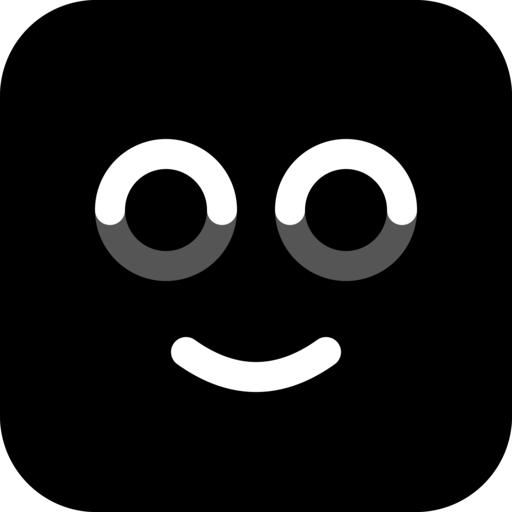

#  About Emkay

An [OpenVoiceOS](https://openvoiceos.org) skill: who the assistant is and
where it comes from. It answers the questions
[ovos-skill-personal](https://github.com/OpenVoiceOS/ovos-skill-personal)
answers ("who are you", "who made you", "when were you born" …), but as
Emkay, and it tells the story behind the name, with the logo of each part on
the screen while it talks.

It is made for [Emkay](https://github.com/emkay-voice/emkay), OpenVoiceOS in
the browser, and takes the place of ovos-skill-personal there.

## Usage

```
"Who are you?"                 "Hvem er du?"
"Who made you?"                "Hvem har lavet dig?"
"Tell me about yourself"       "Fortæl mig om dig selv"
"Why are you called Emkay?"    "Hvorfor hedder du Emkay?"
"What was Mycroft?"            "Hvad var Mycroft?"
"What is OpenVoiceOS?"         "Hvad er OpenVoiceOS?"
```

"Tell me about yourself" tells the whole story, in four parts:

1. **Mycroft**: in 2015 Mycroft AI, a small company in Kansas, set out to
   build an open source voice assistant, and funded its first device, the
   Mark 1, on Kickstarter.
2. **Mark 2**: in 2018 Mycroft launched the Mark 2, with a touch screen and
   a face. The two were known as MK1 and MK2.
3. **OpenVoiceOS**: when Mycroft AI closed in 2023, the OpenVoiceOS
   community carried the work on.
4. **Emkay**: OpenVoiceOS in a web browser. M K, after the Mark 1 and the
   Mark 2.

## Why a skill of its own

ovos-skill-personal's answers come from a few settings (creator, year,
place). A whole story with pictures, in every language, is content rather
than settings, and it is Emkay's content, so it belongs in a skill of its
own, as Neon has its own personal skill. The intents and their translations
are ovos-skill-personal's (Apache-2.0, thanks to the OpenVoiceOS community
and its translators), so the same questions work in every language
ovos-skill-personal knows. The story and Emkay's own questions are in
English and Danish for now; the other languages answer "tell me about
yourself" with who it is.

Install one or the other: with both, two skills compete for the same
questions. Emkay blacklists ovos-skill-personal for that reason.

## The pictures

The skill shows `gui/images/<name>.png` while it talks about each part:
`mycroft.png`, `mark2.png`, `ovos.png` and `emkay.png`. Only Emkay's own
logo is in the package. Mycroft's and OpenVoiceOS' logos and pictures of
the Mark 1 and Mark 2 belong to others, so they are not shipped here; a
part without its picture shows its name instead. To show them, put the
files in `gui/images/` of the installed skill.

## Settings

| setting | default |
|---|---|
| `assistant_name` | Emkay |
| `creator` | Andreas Lorensen |
| `year_of_birth` | 2026 |
| `location_of_birth` | Denmark |

## License

Apache-2.0. The intents and the translations of ovos-skill-personal's
dialogs are from ovos-skill-personal (Apache-2.0).
